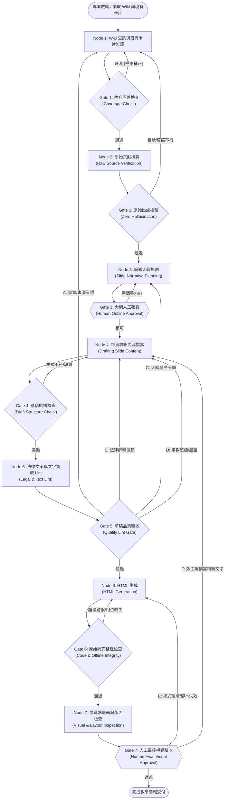
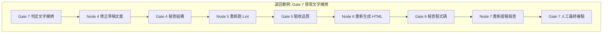

# 戀愛行銷教學簡報製作流程圖與節點規格 (Graph & Node Specifications)

本文件定義以 LLM Wiki 為知識基礎，製作「戀愛行銷與消費者保護」教學 HTML 簡報之執行圖（Execution Graph）、節點關卡規格（Node & Gate Specifications）與完整反饋迴圈（Cascading Feedback Loop）規範。

---

## 一、整體執行架構圖 (Execution Graph)

本流程設有 **7 個執行節點 (Node 1 ~ Node 7)** 與 **7 道對應檢驗關卡 (Gate 1 ~ Gate 7)**，每個節點均有專屬之檢驗閘門，形成嚴密的管線鏈結。

---

## 二、七大節點與檢驗關卡詳細規格 (1:1 對應)

### Node 1: Wiki 資料查詢與既有卡片維護 (`NODE_1_WIKI_QUERY_AND_CARD_MAINTENANCE`)
- **節點定位**：本專案已建立完整的 `wiki/` 知識庫及 11 張證據卡（`slides/evidence-cards.md`）。本節點以「讀取、查詢與補足既有資料」為主。
- **輸入資料**：`wiki/index.md`、`wiki/` 各專題頁面、既有 `slides/evidence-cards.md`。
- **AI 執行工作**：
  1. 讀取並檢視既有 11 張證據卡與 Wiki 的對應關係。
  2. 針對簡報教學主題（戀愛行銷操作、案例、風險、消保法、日本比較法），確認是否有遺漏的重要事實或概念。
  3. **維護鐵律**：**嚴禁直接重新生成或全面覆蓋 `slides/evidence-cards.md`！** 若發現既有卡片有疏漏或錯誤，僅能提出針對特定卡片的「修正建議（Patch/Edit Proposal）」並進行局部補充。
- **預期輸出檔案**：更新後之 `slides/evidence-cards.md`（保留既有 11 張卡片，僅做增補修訂）。
- **檢驗關卡 (Gate 1: 內容涵蓋檢查 `GATE_1_COVERAGE_CHECK`)**：
  - 核心案例（公平會公處字第 112094 號、臺中地院 111 中小 3398 號）與手法涵蓋度達 100%。
  - 涵蓋民眾自保之法定權利與實戰步驟。
- **失敗處理**：若發現核心事實缺漏，由 AI 列出缺漏清單並向 Wiki 檢索後局部增補。

---

### Node 2: 原始文獻核實 (`NODE_2_RAW_SOURCE_VERIFICATION`)
- **節點定位**：杜絕 AI 自我循環驗證，直接將證據卡與 `raw/` 原始 PDF 進行對照核實。
- **輸入資料**：`slides/evidence-cards.md`、`raw/` 資料夾內之 7 份原始 PDF 文件。
- **AI 執行工作**：
  1. 逐張卡片核對處分案號、裁判字號、法條條項款目。
  2. **直接回溯原始文獻**：重要案例事實、法條與法律主張，必須逐字核對至 `raw/` 原始 PDF 的具體頁碼，不得僅憑先前生成之摘要互相背書。
  3. **分層嚴格標示**：在核查紀錄中嚴格區分「原文引句（`> `）」、「Wiki 整理」與「AI 分析」。
  4. **缺漏標記**：若有任何無法在原始 PDF 找到確切字句之內容，一律明確標註 `【⚠️ 待人工確認】`，絕不自行腦補或臆測結論。
- **預期輸出檔案**：`slides/checkpoints/node2-evidence-check.md`（詳細記錄每張卡片之原始 PDF 頁碼核驗紀錄）。
- **檢驗關卡 (Gate 2: 原始出處檢驗 `GATE_2_SOURCE_VERIFICATION`)**：
  - 100% 證據主張均能直接對應原始 PDF 具體頁碼。
  - 無未標註來源之法律主張，無將小額裁判泛化為普遍原則之情形。
- **失敗處理**：若發現案號、法條或頁碼與原始 PDF 不符，退回 **Node 1** 修正該張證據卡。

---

### Node 3: 簡報大綱規劃與大綱審查 (`NODE_3_OUTLINE_PLANNING`)
- **節點定位**：確立面向一般大眾的 10 頁教學敘事架構與內容比例。
- **輸入資料**：`slides/evidence-cards.md`、使用者指導原則、既有 `slides/outline.md`。
- **AI 執行工作**：
  1. 依據「現象手法與案例占 55%、法律介入占 25%、比較法與自保占 20%」之比例維護大綱。
  2. 為每一頁明確訂定：標題、教學重點、要回答的問題、關聯證據卡及預計視覺呈現方式。
  3. **大綱維持**：以目前的 10 頁新版大綱為基準，除非使用者要求調整，不得任意推翻既有架構。
- **預期輸出檔案**：`slides/outline.md`
- **檢驗關卡 (Gate 3: 大綱人工確認 `GATE_3_HUMAN_OUTLINE_APPROVAL`)**：
  - **Human-in-the-Loop 人工閘門**：必須獲得使用者於對話中明確確認核可大綱結構後，方可解鎖進入 Node 4。
- **失敗處理**：若使用者對教學順序、比例或案例選擇提出修正意見，於 **Node 3** 局部調整大綱。

---

### Node 4: 每頁詳細內容撰寫 (`NODE_4_SLIDE_DRAFTING`)
- **節點定位**：將大綱轉化為適合大眾閱讀的白話投影片文字稿與版面視覺規劃。
- **輸入資料**：通過 Gate 3 的 `slides/outline.md`、`slides/evidence-cards.md`。
- **AI 執行工作**：
  1. 逐頁撰寫詳細草稿，包含頁面標題、核心大眾白話文案、情境模擬與版面指示。
  2. 嚴格遵守「法律黑話轉譯」，將法條轉化為一般生活語言，嚴禁直接貼上法條全文。
  3. **強制錨定（Grounding Tag）**：每一頁開頭必須強制標註對應之證據卡編號（例如 `<!-- Grounding: EC-01, EC-02 -->`），文字內容嚴格限制在卡片事實與法律結論內。
- **預期輸出檔案**：`slides/draft.md`
- **檢驗關卡 (Gate 4: 草稿結構檢查 `GATE_4_DRAFT_STRUCTURE_CHECK`)**：
  - 10 頁草稿完整齊全，每頁均具備標題、白話文案、情境規劃及 Grounding 標籤。
  - 無格式遺漏或空白頁面。
- **失敗處理**：若有缺頁或格式不合，針對該頁於 **Node 4** 進行局部補正。

---

### Node 5: 法律文案與文字負載 Lint (`NODE_5_LEGAL_AND_TEXT_LINT`)
- **節點定位**：程式化與語意化雙重稽核草稿品質。
- **輸入資料**：`slides/draft.md`、`slides/evidence-cards.md`。
- **AI 執行工作**：
  1. **真實性約束稽核**：比對每頁內容是否 100% 來自其標註之證據卡，嚴禁出現卡片外的新判決、新條文或虛構數據。
  2. **文字負載檢驗**：單頁漢字總量不得超過 160 字，防止投影片文字擁擠不堪。
  3. **白話轉譯檢驗**：檢查是否殘留艱澀法律名詞（如自然債務、形成權），必須轉化為生活常識說明。
  4. **警示標籤檢驗**：確認日本約會商法內容已標註「此為日本法律，我國尚無相同明文」。
- **預期輸出檔案**：`slides/checkpoints/node5-lint-report.md`
- **檢驗關卡 (Gate 5: 草稿品質驗收 `GATE_5_LEGAL_AND_TEXT_LINT`)**：
  - Lint 報告 0 Error。
- **失敗處理（依問題類型定向退回，並執行下游鏈式重跑）**：
  - 發現未經證實事實 ➔ 退回 **Node 1**（修正卡片）。
  - 法律解釋偏頗或黑話殘留 ➔ 退回 **Node 4**（改寫該頁文案）。
  - 單頁字數超過 160 字 ➔ 退回 **Node 4**（文字瘦身）。
  - 順序不符合大眾認知 ➔ 退回 **Node 3**（調整大綱）。

---

### Node 6: HTML 生成 (`NODE_6_HTML_GENERATION`)
- **節點定位**：純粹渲染器（Pure Renderer），將核可草稿編譯為單一 HTML 簡報。
- **輸入資料**：通過 Gate 5 的 `slides/draft.md`。
- **AI 執行工作**：
  1. 生成單一獨立、離線可執行的 `slides/presentation.html`。
  2. 整合現代 CSS 樣式系統（深淺對比、大字體、響應式投影片卡片）。
  3. 整合原生 JavaScript 鍵盤翻頁（左右鍵）、點擊導航與進度條控制。
  4. **嚴禁額外腦補**：本節點僅負責排版與樣式程式碼，**嚴禁在編寫 HTML 時自行增加未收錄於 draft.md 的任何文字內容**。
  5. 嚴禁引入外部 CDN，所有圖標採用內嵌 SVG，字體採用系統標準字體，確保離線環境 100% 正常顯示。
- **預期輸出檔案**：`slides/presentation.html`
- **檢驗關卡 (Gate 6: 原始碼完整性檢查 `GATE_6_CODE_INTEGRITY_CHECK`)**：
  - HTML5 語法標準校驗（所有標籤正常閉合、CSS/JS 語法無報錯）。
  - 無外部 HTTP/HTTPS CDN 相依性（100% 離線可用）。
  - 10 頁 DOM 節點完整無缺。
- **失敗處理**：若語法不合或相依性缺失，於 **Node 6** 修正 HTML/CSS/JS 程式碼。

---

### Node 7: 瀏覽器畫面與版面檢查 (`NODE_7_VISUAL_INSPECTION`)
- **節點定位**：嚴格區分「程式碼自動檢查」與「瀏覽器真實畫面檢查」。
- **輸入資料**：通過 Gate 6 的 `slides/presentation.html`。
- **AI 執行工作與檢查界限**：
  1. **原始碼靜態檢查（Agent 自動執行）**：檢查容器尺寸、行高、文字截斷預警機制。
  2. **明確誠實揭露檢查極限**：若 Agent 未透過實際瀏覽器渲染畫面，**嚴禁宣稱「視覺畫面檢查通過」**！
  3. **產出待人工檢查清單**：Agent 產出 `slides/checkpoints/node7-inspection-report.md`，詳列建議使用者在真實瀏覽器中檢查之項目（如投影片切換流暢度、高解析度螢幕排版、手機版自適應、文字對比舒適度）。
- **預期輸出檔案**：`slides/checkpoints/node7-inspection-report.md`
- **檢驗關卡 (Gate 7: 人工最終視覺驗收 `GATE_7_HUMAN_FINAL_APPROVAL`)**：
  - **Human-in-the-Loop 人工閘門**：由使用者實際以瀏覽器開啟 `slides/presentation.html` 進行畫面預覽，並於對話中確認視覺效果與操作體驗滿意，始算全案通過。
- **失敗處理**：
  - 樣式破版、翻頁異常 ➔ 退回 **Node 6**（修改 CSS/JS）。
  - 畫面文字依然擁擠 ➔ 退回 **Node 4**（精簡文案草稿）。

---

## 三、退回反饋迴圈與「下游鏈式重跑」規則 (Cascading Feedback Loop)

### 1. 核心原則：下游鏈式重跑 (Cascading Downstream Re-execution)
為確保最終產出之 HTML、草稿與證據卡時時刻刻保持 100% 同步，**任何節點在退回修正後，都必須依序重新執行受影響的下游節點與 Gate，嚴禁跳步直達！**

### 2. 定向退回路由表：

| 觸發問題類型 | 攔截檢查點 | 退回目標節點 | 下游必須重新經過之路徑 | 最大重試 | 超過次數處理 |
| :--- | :---: | :---: | :--- | :---: | :--- |
| **A. 案例事實或頁碼錯誤** | Gate 2 / Gate 5 | ➔ **Node 1** | **Node 1** ➔ Gate 1 ➔ **Node 2** ➔ Gate 2 ➔ **Node 4** ➔ Gate 4 ➔ **Node 5** ➔ Gate 5 | 3 輪 | 中止並請求使用者裁決 |
| **B. 法律解釋偏頗或誤導** | Gate 5 | ➔ **Node 4** | **Node 4** ➔ Gate 4 ➔ **Node 5** ➔ Gate 5 | 3 輪 | 中止並請求使用者裁決 |
| **C. 教學順序或結構混亂** | Gate 3 / Gate 5 | ➔ **Node 3** | **Node 3** ➔ Gate 3 (人工確認) ➔ **Node 4** ➔ Gate 4 ➔ **Node 5** ➔ Gate 5 | 3 輪 | 提示使用者手動定錨 |
| **D. 單頁字數過多 / 黑話殘留** | Gate 5 | ➔ **Node 4** | **Node 4** ➔ Gate 4 ➔ **Node 5** ➔ Gate 5 | 3 輪 | 強制精簡文字至 140 字 |
| **E. HTML 渲染破版 / 腳本失效** | Gate 6 / Gate 7 | ➔ **Node 6** | **Node 6** ➔ Gate 6 ➔ **Node 7** ➔ Gate 7 (人工確認) | 3 輪 | 改採極簡穩健版型 |
| **F. 實際畫面文字過多需要精簡** | Gate 7 | ➔ **Node 4** | **Node 4** ➔ Gate 4 ➔ **Node 5** ➔ Gate 5 ➔ **Node 6** ➔ Gate 6 ➔ **Node 7** ➔ Gate 7 | 3 輪 | 人工介入裁示取捨 |

---

## 四、實際執行紀錄留存規範 (Execution Logging)

為符合期末作業成果展示與反思報告需求，所有流程均採取**即時持久化記錄**，嚴禁事後虛構或事後補記：

1. **狀態追蹤檔 (`slides/state.json`)**：
   - 即時記錄當前節點（`current_node`）、各關卡狀態（`PASS` / `FAIL` / `WAITING_USER_APPROVAL` / `PENDING`）、各節點累積重試次數（`retry_counts`）。
   - 在 `history` 陣列中，以 ISO 8601 時間戳記即時追加每次動作紀錄（包括執行的節點、產出的檔案、檢查結果、退回原因與修正摘要）。
2. **查核歷史報告存檔 (`slides/checkpoints/`)**：
   - `node2-evidence-check.md`：記錄原始 PDF 具體頁碼核對紀錄與查證註記。
   - `node5-lint-report.md`：記錄每輪草稿的文字數量、黑話轉譯與 Grounding 比對報告。
   - `node7-inspection-report.md`：記錄原始碼檢查報告與提示使用者的真實瀏覽器畫面檢查清單。