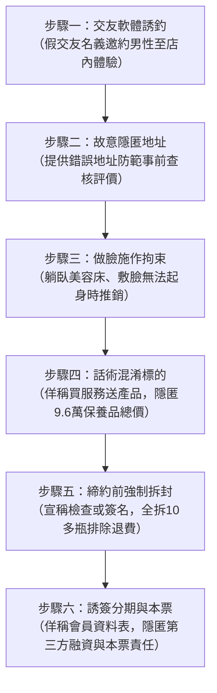

# 案例解析：公平會公處字第 112094 號處分案（衣渼爾交友行銷案）

## 一、處分案基本資訊
- **處分機關**：公平交易委員會
- **處分案號**：公處字第 112094 號
- **處分日期**：中華民國 112 年 12 月 4 日
- **被處分人**：林○即錦瑪企業社（統一編號：88439126，市招名稱：「衣渼爾」）
- **處分主文**：
  1. 違法行為認定：違反公平交易法第 25 條，命立即停止違法行為（頁 1）。
  2. 罰鍰金額：處新臺幣 100 萬元罰鍰（頁 1）。
- **案由**：利用交友軟體隱匿推銷目的、藉體驗做臉拘束煩擾推銷、隱匿保養品價量與分期本票資訊、強迫預拆商品排除退費。

---

## 二、被處分人之整體違法行銷手法（頁 1–7、11–19）

公平會調查顯示，被處分人發展出一套具高度計畫性與步驟性之不當行銷流水線：

### 1. 步驟一：交友軟體誘釣（頁 2、11–12）
- 旗下多名女性美容師於交友軟體尋找結交異性對象（客群 8 至 9 成為男性），藉由聊天建立好感，再以「探班」、「見面約會」或「捧場衝業績」為由，邀約至店內進行 1,500 元至 1,700 元之單次體驗。

### 2. 步驟二：提供錯誤店址排除查證（頁 3、12–13）
- 故意不提供店名或提供鄰近錯誤地址（如員林市新生路 289 號，實為 281 號），待顧客抵達後電話引導進店，防範消費者事前上網搜尋店家負面評價。

### 3. 步驟三：利用施作做臉限制身體與煩擾推銷（頁 2、13–14）
- 趁消費者臉部覆蓋毛巾、塗滿保養品躺臥於美容床無法起身之際，美容師進房疲勞轟炸推銷。消費者多次婉拒，仍持續推銷或情緒勒索，使其自由意識受壓抑，在倉促無暇思考下妥協。

### 4. 步驟四：混淆「買服務」與「買保養品」，隱匿價量總額（頁 2、14–16）
- 先試探每月預算（如 4,000–5,000 元），以「可做臉次數」包裝推銷，使消費者誤以為購買可隨時退費之服務課程；實則係購買整套保養品（總額達 9 萬 6,000 元），且簽約前未出示商品品項、單價及總價。

### 5. 步驟五：締約前強拆商品包裝並簽名（頁 2、4、18–19）
- 在出示契約書前，藉口「檢查有無瑕疵」或「簽名防拿錯」，主動將十多瓶全新保養品全數拆封並令消費者簽名，事後再以「商品已拆封無從回復原狀」為由，主張契約約定扣除 60% 費用與 1 萬元手續費，惡意排除消費者解約退費。

### 6. 步驟六：隱匿第三方融資與併簽本票（頁 3–4、16–17）
- 以加入會員為由要求簽寫「資料表」，實質遮蔽標題申請第三方購物分期債權轉讓；申請書下方併印有「本票」，消費者於不知情下簽署，承擔票據法第 123 條被聲請裁定強制執行之高風險。

---

## 三、公平交易委員會之裁處理由（頁 8–11、19–20）

1. **合致「欺罔」要件**（頁 9）：
   - 隱匿推銷商品真實目的。
   - 隱匿正確營業處所地址，排除消費者事前查證可能。
   - 隱匿交易標的為商品之重要資訊，誤導為服務課程。
   - 隱匿辦理第三方融資借貸與簽署本票之法律風險。
2. **合致「顯失公平」要件**（頁 9）：
   - **不當招攬**：趁消費者接受做臉服務、身體受拘束無從離開之際進行煩擾推銷，壓抑自由意思（頁 9、13–14）。
   - **利用資訊不對稱**：未揭露商品品項價格，主導搭配商品（頁 9、15）。
   - **妨礙權利行使**：締約前令消費者全數拆封商品，故意製造退貨障礙（頁 9、18–19）。
   - **定型化契約不當行為**：未給予合理審閱期，訂定高額拆封扣款條款（頁 9、18）。
3. **合致「足以影響交易秩序」要件**（頁 10、19）：
   - 違法行為期間長達 2 年，受害人數眾多，具備組織性、計畫性與步驟性，對美容市場交易秩序及潛在多數消費者構成重大危害，依公平法第 42 條裁處 100 萬元罰鍰（頁 20）。

---

## 四、實務意涵與待查證爭點（AI 分析）

1. **公權力介入戀愛行銷之定錨標準**：
   - 本案確立：事業即便包裝成「交友自由」或「員工個人社交行為」，只要整體營業模式具備誘導至店內進行不當推銷之步驟性，即受公平交易法規制，不得藉私法自由卸責。
2. **【⚠️ 尚待查證】消保法特種買賣適用之交錯**：
   - 處分書中載明消費者多要求依消保法主張 7 日解約權（頁 3、6）。然而實務上業者常抗辯「消費者係自行來到實體營業所消費，非訪問交易，無 7 日無條件解約權」，或抗辯「保養品已拆封屬合理例外情事不得退費」。此類抗辯在法院民事裁判與消保官協商中如何被認定，有待後續地院判決進一步釐清。

---

## 五、關聯頁面
- [[../sources/source-judgment-ftc-112094.md|來源文獻：公平會公處字第 112094 號處分書摘要]]
- [[../concepts/deceptive-and-unfair-practices.md|概念庫：公平交易法第 25 條欺罔與顯失公平]]
- [[../legal-issues/dating-marketing-unfair-trade-practices.md|爭點庫：戀愛行銷之手法定性與公平交易法第 25 條之適用]]
