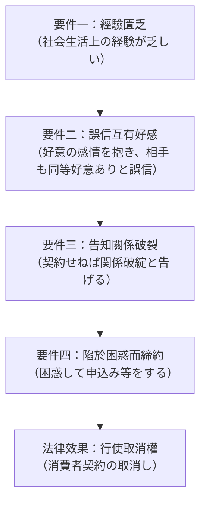

# 概念解析：日本法「約會商法」與好意感情不當利用取消權 (Japanese Dating Commercial Law)

> [!WARNING] 比較法與法制差異重要聲明
> 本頁面所解析之制度係屬**日本國《消費者契約法》（消費者契約法）**之專屬民事規定。
> **我國現行法制（民法、消費者保護法）目前並無直接對等之「好意感情不當利用取消權」法定明文**，不得自行將日本法規等同於我國現行法，本頁面僅作為比較法分析與政策修法之借鏡。

---

## 一、日本法「約會商法（デート商法）」之定義與問題意識

在日文中，**「デート商法」**（約會商法／戀愛商法）係指事業人員（勧誘者）刻意接近消費者，藉由培養戀愛、親密好感等感情，利用對方難以拒絕或害怕感情破裂之心理狀態，誘使消費者締結高額商品、服務或餐飲消費契約之行銷手段（日本消費者廳，2023，頁 1）。

近年日本惡質男公關俱樂部（ホストクラブ，Host Club）從業人員（ホスト）普遍針對年輕女性顧客，利用情感勒索誘使大量點購高額酒水餐飲，導致消費者背負龐大掛帳賒欠債務（売掛金），甚至衍生迫使被害人從事風俗性產業或非法借貸之嚴重社會問題（日本消費者廳，2023，頁 1、3）。

---

## 二、日本《消費者契約法》第 4 條第 3 項第 6 號之取消權體系

為解決「約會商法」造成的民事契約損害，日本消費者契約法於第 4 條第 3 項第 6 號明定消費者享有法定之**取消權（取消権）**。

日本消費者廳於令和 5 年（2023 年）11 月 30 日發布之官方指引，將該條構成要件解析為四大核心要素（日本消費者廳，2023，頁 1、頁 4）：

### 1. 構成要件分解
1. **消費者の社会生活上の経験が乏しいこと（社會生活經驗匱乏）**：
   - 指消費者社會經驗之累積，不足以就該消費契約是否締結做出客觀妥當之判斷（頁 4）。
   - **年齡無絕對限制**：不僅限於甫成年之年輕人，中高齡者若對特定社交或消費領域欠缺經驗，亦可該當（頁 4）。
2. **好意感情の誤信（誤信彼此互有戀愛或好意感情）**：
   - 消費者對招攬者（如男公關 ホスト）抱持戀愛或好意之感情；且
   - 消費者「誤信」招攬者對自己亦抱持同樣之戀愛或好意感情（例如透過甜言蜜語、曖昧通訊訊息，使客深信兩人正在交往）（頁 1、4）。
   - *感情範疇*：不限於男女戀愛，對友人、前輩超越普通客氣之親密情感亦包含在內（頁 4）。
3. **関係破綻の告知（明知並乘機告知若不簽約將導致人際關係破裂）**：
   - 招攬者明知消費者深陷情感依附，乘機向消費者表示「若不締結契約（例如不加點昂貴香檳、不購買套裝行程），雙方關係將無法維持／將會破裂」（頁 1、4）。
   - *告知方式*：不以嚴格字面為限，實質上讓消費者認識到「不花錢就代表感情破裂」即足當之（頁 4）。
4. **困惑（消費者因憂懼關係破裂而陷於困惑並締約）**：
   - 消費者在此心理困窘與自由意志受壓抑下，同意締結飲食或商品契約（頁 1）。

### 2. 法定效果與抗辯排除
- **行使取消權之效果**：消費者得向業者行使取消之意思表示（取消しの意思表示），使契約溯及無效（頁 1）。
- **排除「私人間戀愛借貸」抗辯**：
  > 招攬者縱使辯稱「這是情侶之間的私下金錢墊付借貸（売掛金の立替え）」，只要招攬者實質上該當法律上的事業者，仍應適用本條取消規定，不容以私法假借貸逃避規範（頁 1–2）。

---

## 三、其他關聯日本法條事由
在男公關或約會商法中，消費者亦可能併同主張其他取消權（日本消費者廳，2023，頁 2）：
- **不実告知（第 4 條第 1 項第 1 號）**：招攬時虛偽陳述商品價格或重要交易內容。
- **退去妨害（第 4 條第 3 項第 2 號）**：消費者表明欲離開營業所，招攬者卻以身體阻擋或持續威嚇不讓其離開。
- **未成年者取消（日本民法第 5 條）**：未滿 18 歲之未成年人未經法定代理人同意之契約，原則上得直接撤銷（頁 1）。

---

## 四、對我國法制之借鏡與對照（AI 比較法分析）

1. **我國現行救濟瓶頸**：
   - 我國消費者遇到類似「假交友戀愛推銷」時，在民法上常因無法證明「急迫」（現有法益受緊急危難）而無法適用民法第 74 條（見最高法院 110 年度台上字第 534 號判決意旨）。
   - 主張民法第 92 條詐欺，又常陷入「甜言蜜語是否構成法律上詐欺故意」之舉證泥淖。
2. **日本法立法的精密之處**：
   - 日本消費者契約法跳脫傳統「金錢客觀對價是否暴利」的框架，直接精準鎖定「利用好意感情與關係破綻威脅」之心理強制機制，賦予受害人專屬取消權，值得我國未來修正消費者保護法時審慎研議。

---

## 五、參考文獻與出處
- 日本消費者庁 消費者制度課（令和 5 年 11 月 30 日），《ホストクラブなどにおける不当な勧誘と消費者契約法の適用について（周知）》，頁 1–4。
- 日本《消費者契約法》第 4 條第 1 項、第 4 條第 3 項第 2 號、第 4 條第 3 項第 6 號。
- 日本《民法》第 5 條。
